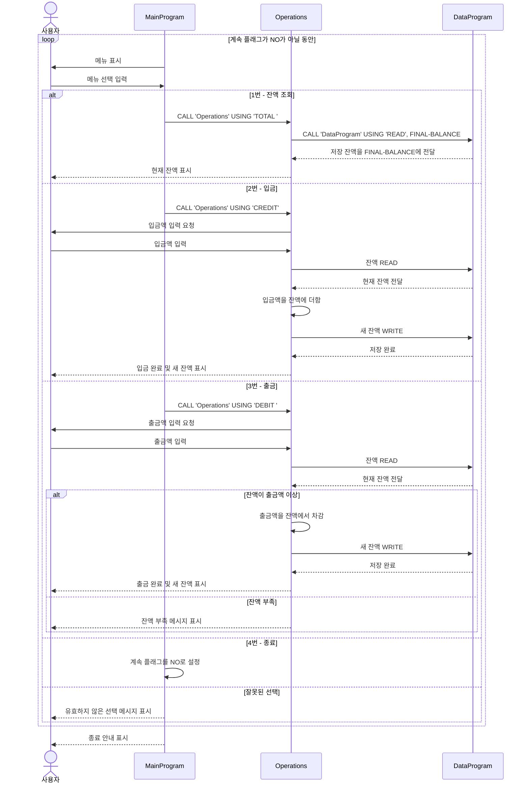

# COBOL 학생 계좌 관리

이 문서는 `src/cobol`의 COBOL 계좌 관리 예제를 설명합니다. 프로그램 메뉴에서 계좌 잔액 조회, 입금, 출금을 선택할 수 있습니다.

## 소스 파일

### `main.cob` - `MainProgram`

계좌 관리 메뉴를 표시하고 사용자의 선택을 입력받습니다. 잔액 조회에는 `TOTAL `, 입금에는 `CREDIT`, 출금에는 `DEBIT ` 값을 전달해 `Operations`를 호출합니다. 4번을 선택하면 프로그램을 종료하고, 그 외의 유효하지 않은 선택에는 오류를 표시한 뒤 메뉴로 돌아갑니다.

### `operations.cob` - `Operations`

`MainProgram`에서 요청한 계좌 작업을 수행합니다.

- `TOTAL `은 저장된 잔액을 읽어 표시합니다.
- `CREDIT`은 금액을 입력받아 현재 잔액에 더하고, 새 잔액을 저장한 뒤 표시합니다.
- `DEBIT `은 금액을 입력받고 현재 잔액이 출금액 이상인지 확인합니다. 출금할 수 있으면 잔액에서 차감해 저장하고, 잔액이 부족하면 오류를 표시하며 잔액을 변경하지 않습니다.

### `data.cob` - `DataProgram`

잔액 저장 인터페이스를 제공합니다. `READ` 작업은 저장된 잔액을 호출 프로그램에 전달하고, `WRITE` 작업은 호출 프로그램이 전달한 값으로 저장된 잔액을 바꿉니다. 초기 잔액은 `1000.00`입니다.

## 학생 계좌 규칙 및 제한 사항

- 이 예제는 잔액 하나만 관리합니다. 학생 ID, 계좌 조회, 학생별 잔액 기능이 없으므로 학생마다 계좌를 구분하지 않습니다.
- 출금액이 현재 잔액을 초과하지 않을 때만 출금할 수 있습니다. 잔액이 부족하면 저장된 잔액은 변경되지 않습니다.
- 입금액은 잔액에 바로 더합니다. 입금 한도나 입력 금액 검증은 구현되어 있지 않습니다.
- 금액과 잔액은 `PIC 9(6)V99` 형식을 사용합니다. 부호 없는 숫자이며 소수점 이하 두 자리와 최대 여섯 자리의 정수부를 표현합니다. 프로그램은 유효하지 않은 입력을 명시적으로 거부하거나 필드가 표현할 수 있는 범위를 벗어나는 값을 방지하지 않습니다.
- 잔액은 COBOL 작업 저장 영역에 보관되며 `1000.00`으로 시작합니다. 파일이나 데이터베이스를 통한 영구 저장은 구현되어 있지 않으므로, 이 값을 지속적으로 보관되는 계좌 데이터로 간주해서는 안 됩니다.

## 앱 시퀀스 다이어그램

